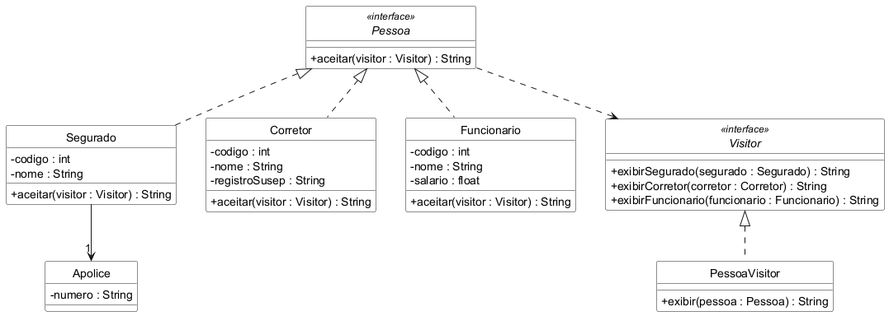

# Visitor

Trabalho da disciplina Aspectos Avançados em Engenharia de Software.

Exemplo do padrão Visitor em Java, com testes em JUnit 5. O tema é o mesmo da
seguradora usada nos trabalhos anteriores, agora com as pessoas que aparecem no
sistema: o segurado (com a apólice dele), o corretor (com o registro na SUSEP)
e o funcionário da seguradora (com o salário).

Cada pessoa tem o método `aceitar`, que recebe o visitor e chama o método certo
para o seu tipo. O `PessoaVisitor` concentra a forma de exibir cada um, então
para criar uma operação nova sobre essas pessoas basta criar outro visitor, sem
mexer nas classes `Segurado`, `Corretor` e `Funcionario`.

## Diagrama de classes

